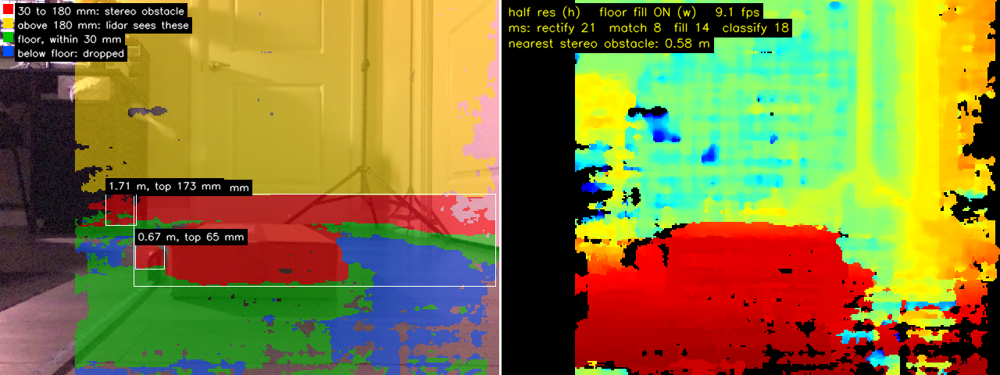

# ROS2 Rover Stereo Perception - Jetson + Stereo Depth

The second phase of a 4WD autonomous rover built on the Waveshare UGV02 with an NVIDIA
Jetson Orin Nano Super. A calibrated IMX219 stereo camera adds depth perception to a
rover that already maps and explores a house on its own with ROS2 Humble, slam_toolbox,
Nav2, and a custom frontier explorer.


## Project Overview

**Goal:** One press of EXPLORE on the handheld pendant, and the rover maps the house,
avoids a shoe below the lidar's scan plane, crosses the rug without getting stuck, stops
for a person in its path, and saves a colored 3D layer on top of the lidar map.

**Why This Project:**
- The lidar scans a single plane 180 mm above the floor, so anything lower is invisible
  to it
- Learn stereo calibration and metric depth on real hardware
- Feed camera depth into the Nav2 costmap through standard ROS2 interfaces
- Add person detection and a colored 3D map on an embedded GPU platform
- Document real engineering problem-solving

### Built on Project #1

This project continues
[WaveShare-Jetson-ROS2-Rover](https://github.com/ArshamFN/WaveShare-Jetson-ROS2-Rover),
which ended with the rover mapping the house on its own after one press of EXPLORE. One
of the main goals of Project #2 is to work on top of Project #1 without major changes to
it:

- Project #1's code was copied into this repository once, unchanged, in the first commit,
  from Project #1's final commit (`a44e896`).
- Project #1's nodes stay as they were, with two exceptions: the pendant control node,
  because it names the systemd services it starts, and the exploration autosave node's
  default folders for maps and run logs.
- Configuration, launch files, the URDF, and the systemd service files may change.
- Project #1's repository is never modified.
- On the rover, the two projects live in separate workspaces and are never sourced
  together.

## Hardware Platform

| Component | Specification |
|-----------|---------------|
| **Platform** | Waveshare UGV02, 4WD skid-steer chassis |
| **Compute** | NVIDIA Jetson Orin Nano Super Developer Kit (8GB), 25W mode |
| **LiDAR** | Slamtec RPLidar C1, 10Hz, scan plane 180 mm above the floor |
| **Stereo camera** | Waveshare IMX219-83: two 8MP IMX219 sensors, 60 mm baseline (60.18 mm calibrated), 2.6 mm lenses, on the Jetson's two CSI ports |
| **Camera IMU** | ICM20948 on the camera board, on the Jetson's I2C bus 7 |
| **Camera mount** | 3D-printed case shared with the LiDAR: lens centre 23 mm below the scan plane and 156 mm above the floor |
| **Motor control** | Waveshare Multi-Functional Driver (MFD) board over USB serial |
| **Power** | 3× 18650 cells in series via the Waveshare UPS Module 3S |

The two IMX219 sensors are not hardware-synchronised: each free-runs at 30 fps, so a left
and a right frame can be up to about 33 ms apart.

## Software Stack

- **Operating System:** Ubuntu 22.04 LTS (JetPack 6.2.1)
- **ROS Distribution:** ROS2 Humble Hawksbill
- **From Project #1:** slam_toolbox, rf2o_laser_odometry, Nav2 with Regulated Pure
  Pursuit, `rover_explorer`, and `foxglove_bridge` for the handheld pendant
- **Camera capture:** NVIDIA Argus through GStreamer (`nvarguscamerasrc`), 1640×1232 at
  30 fps scaled to 640×480
- **Stereo depth:** OpenCV 4.5.4 semi-global block matching (SGBM) on the CPU
- **Development Languages:** Python 3.10, C++17

## Current Status

**Last Updated:** November 12, 2026

The stereo camera is mounted, calibrated, and measuring distance correctly to 2 m. After
rectification, the left and right images line up to 0.34 px on average, and the
calibrated baseline is 60.18 mm against 60 mm measured with calipers. Against a tape
measure, depth reads within 1.8% from 0.5 to 2 m.

The floor was measured once instead of being estimated every frame: the camera sits
156 mm above the floor and points about 1.1° up, and with that plane the floor reads flat
within 3.5 mm from 0.35 to 1.5 m. Everything the camera sees is sorted by height above
the floor, and obstacles from 3 to 18 cm tall, below the LiDAR's scan plane, are detected
in a standalone viewer at 9 fps on the Jetson. An 87 mm box read 90 to 91 mm tall.



*Red: 3 to 18 cm above the floor, below the LiDAR's scan plane. Yellow: taller, seen by the
LiDAR too. Green: floor. Blue: below the floor, dropped.*

The repository holds Project #1's code, pointed at this workspace with its own service
names and folders, and the rover runs Project #1's whole stack from it: in a test run from
the pendant, bringup, Nav2 and exploration of one room worked as before, and the map and
run log landed in this project's own folders.

### Completed Milestones

**Hardware:**
- ✅ IMX219-83 stereo camera mounted level in a 3D-printed case shared with the RPLidar C1
- ✅ Camera IMU wired to the Jetson and read: the mount is level to 0.2° at rest

**Software:**
- ✅ Stereo calibration: 0.47 px reprojection error, rows aligned to 0.34 px, baseline
  60.18 mm
- ✅ Depth checked against a tape measure: within 1.8% from 0.5 to 2 m
- ✅ Floor plane measured once with a checkerboard on a box top: the floor reads flat within
  3.5 mm from 0.35 to 1.5 m
- ✅ Floor matching improved by pre-shifting the right image by the floor's expected
  disparity: correct floor readings doubled on the test scene
- ✅ Obstacles from 3 to 18 cm tall detected in a standalone viewer at 9 fps on the Jetson
  (25W, half resolution)
- ✅ Project #1's code imported unchanged as this repository's first commit
- ✅ Project #1's stack runs from this repository with its own services and its own map
  and run-log folders; one script switches the rover between the two projects

## Getting Started

### Requirements

- A rover set up as in
  [Project #1's Getting Started](https://github.com/ArshamFN/WaveShare-Jetson-ROS2-Rover#getting-started):
  the ROS packages, the `/dev/rover` udev symlink, lingering for user services, the
  pendant's power-off permission, the network watchdog, and the Foxglove layout on the
  pendant. Project #2 uses all of them as they are.

### Build

The repository is a complete colcon workspace and lives at `~/stereo_ws`, next to
Project #1's `~/ros2_ws`. The two hold packages with the same names, so they are never
sourced together. Build in a shell where only ROS2 Humble is sourced: colcon writes every
workspace sourced at build time into the setup files it generates, so a build started
from a shell with `~/ros2_ws` sourced would load Project #1's packages underneath this one.

```bash
git clone https://github.com/ArshamFN/ROS2-Rover-Stereo-Perception.git ~/stereo_ws
cd ~/stereo_ws
vcs import src < rover.repos
env -i HOME="$HOME" USER="$USER" PATH="$HOME/.local/bin:/usr/local/bin:/usr/bin:/bin" LANG=C.UTF-8 \
  bash --norc --noprofile -c 'source /opt/ros/humble/setup.bash && colcon build --symlink-install'
```

`grep -rl ros2_ws install/` should then print nothing.

### Services

Only one project's services run at a time: both use the MFD board's serial port, the
LiDAR, the cameras, the pendant's topics, and Foxglove's port 8765. Project #2's services
have their own names, so both sets stay installed side by side.

| Service | Starts | Runs |
|---|---|---|
| `stereo-rover-bridge` | at boot | `foxglove_bridge` |
| `stereo-rover-control` | at boot | the `pendant_bridge` control node |
| `stereo-rover-bringup` | on demand | `bringup.launch.py` without RViz, then `rover_zero_motors.py` after every stop or crash |
| `stereo-rover-nav2` | on demand | Nav2, stopping whenever bringup stops |
| `stereo-rover-explore` | on demand | `explore.launch.py`, only while bringup and Nav2 run |

Install them, then move the rover from Project #1's services to these:

```bash
~/stereo_ws/tools/systemd/install.sh
~/stereo_ws/tools/systemd/switch_to_project2.sh
```

`install.sh` installs the five services and enables nothing. `switch_to_project2.sh`
stops and disables `rover-bridge` and `rover-control`, then enables and starts
`stereo-rover-bridge` and `stereo-rover-control`; `switch_to_project1.sh` does the
reverse. Both run without sudo and refuse while either project's bringup, Nav2, or
exploration is running, so stop the stack from the pendant first. The choice holds across
reboots. Reconnect the pendant after a switch.

### Run

The pendant works as in
[Project #1](https://github.com/ArshamFN/WaveShare-Jetson-ROS2-Rover#handheld-pendant):
BRINGUP, NAV2, and EXPLORE start the stack and exploration. A run's final map goes to
`~/stereo_ws/maps/explore_<YYYYMMDD-HHMMSS>_final.pgm` and `.yaml`, and its checkpoints,
pose graphs, `events.csv`, and `battery.csv` to
`~/stereo_rover_runs/explore_<YYYYMMDD-HHMMSS>/`.

### Repository Layout

```
.gitignore  LICENSE  README.md  rover.repos
docs/testing/              session logs
images/testing/            screenshots and figures for the session logs
maps/                      maps saved from the pendant and by exploration (not tracked)
scripts/                   motor calibration and test scripts from Project #1
tools/systemd/             systemd user services for the pendant, the stack, and exploration,
                           and scripts that switch the rover between Project #1 and Project #2
tools/network/             network watchdog: home Wi-Fi or the rover's own network
tools/stereo_calib/        stereo camera test, calibration, and depth viewer scripts
src/rover_driver/          /cmd_vel to MFD bridge
src/robot_description/     URDF, launch files, and parameters
src/pendant_bridge/        pendant control node
src/rover_explore/         frontier explorer and map autosave node
src/rf2o_laser_odometry/   not tracked; pulled via rover.repos
src/rplidar_ros/           not tracked; pulled via rover.repos
src/m-explore-ros2/        not tracked; pulled via rover.repos
```

Everything under `src/`, `scripts/`, and `tools/`, except `tools/stereo_calib/`, started as
Project #1's code. The copy now points at this workspace, with its own systemd service
names and its own folders for maps and run logs. Project #1's documentation, maps, and CAD
files stay in its own repository. `tools/stereo_calib/` holds this project's own camera
scripts from Session 001.

## Documentation

- [Test Logs & Build Journal](docs/testing/0000-test-logs.md): session-by-session build
  history of Project #2
- [Project #1 Test Logs & Build Journal](https://github.com/ArshamFN/WaveShare-Jetson-ROS2-Rover/blob/main/docs/testing/0000-test-logs.md):
  sessions 000 to 017, from first setup to autonomous mapping

## Author

**Arsham Faghihnasiri**

Building autonomous systems and learning production ROS2 development.

- 📍 Greater Toronto Area, Ontario, Canada
- 💼 [LinkedIn](https://www.linkedin.com/in/arsham-faghihnasiri)
- 📧 arshamfaghihnasiri@gmail.com
- 🎓 Software Engineering

## Acknowledgments

- Waveshare for the UGV02 platform, the MFD board, and the IMX219-83 stereo camera
- NVIDIA for Jetson developer tools and documentation
- Slamtec for the RPLidar SDK and ROS2 driver
- The OpenCV project
- MAPIRlab for rf2o_laser_odometry, and Adlink-ROS for its ROS2 port
- Jiří Hörner for explore_lite, and robo-friends for its ROS2 port, m-explore-ros2
- The ROS2 and Nav2 open source communities

## License

MIT License. See [LICENSE](LICENSE) for details.
