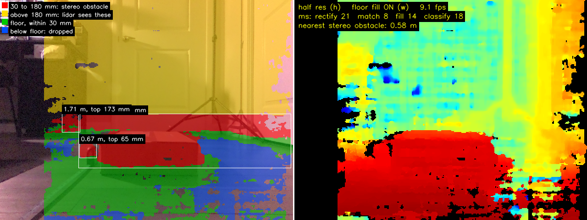
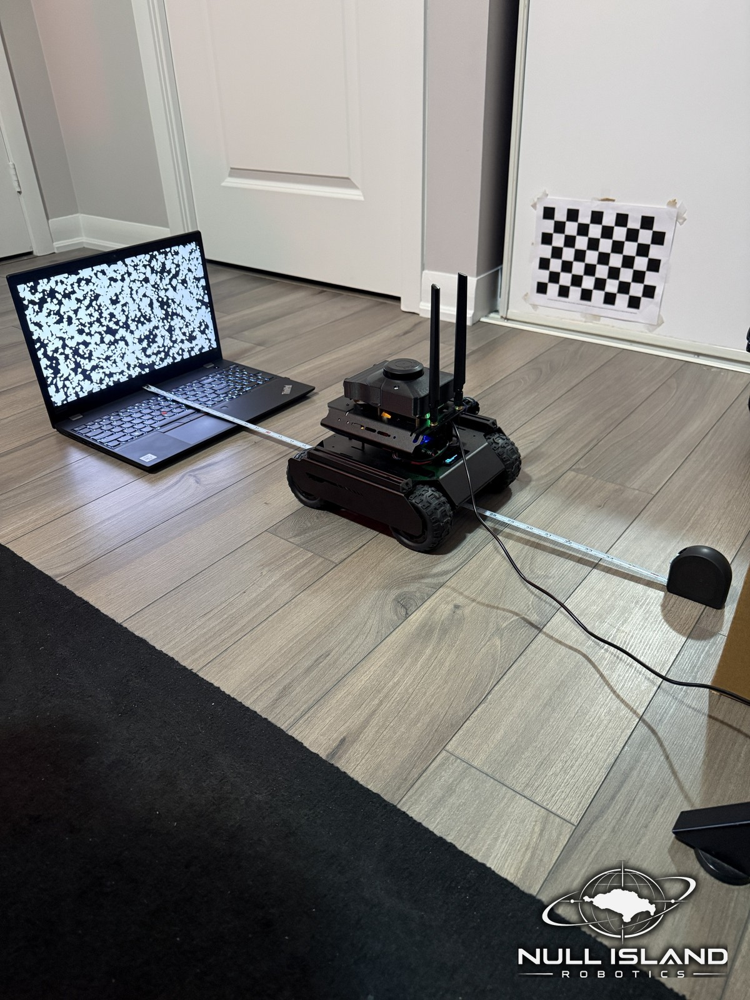

# Test Logs & Build Journal

## Purpose
This file serves as an index of all Project #2 session logs. Each session has its own
dedicated file in this folder with full details. Project #1's sessions, 000 to 017, are in
the [WaveShare-Jetson-ROS2-Rover](https://github.com/ArshamFN/WaveShare-Jetson-ROS2-Rover/blob/main/docs/testing/0000-test-logs.md)
repository.

---

## Session Index

| Session | Date | Title | Status |
|---------|------|-------|--------|
| 001 | 2026-11-05 | Mounting and Calibrating the Stereo Camera, and Finding the Floor | ✅ Complete |
| 002 | 2026-11-10 | The Stereo Camera Node, and Lining It Up With the Lidar | ✅ Complete |

---

## Session 001 — 2026-11-05: Mounting and Calibrating the Stereo Camera, and Finding the Floor
**Goal:** Mount the stereo camera on the rover, calibrate it, check its distances against a
tape measure, and find out how well it sees the floor and the low obstacles the lidar
misses.

**Summary:** I designed a new case that holds the lidar and the stereo camera, with the
lens 23 mm below the lidar's scan plane. The first calibration failed because a hand-held
board moves between the two cameras' unsynchronised exposures. The second passed every
quality check and still read 4.8% short against a tape measure; synthetic tests traced it
to the focal length, which near face-on poses barely constrain, and to a corner search
window wider than the far squares. The third calibration, with every pose tilted 30 to
50°, reads within 1.8% from 0.5 to 2 m, with a 60.18 mm baseline against 60 mm measured.
The floor was the hardest thing to see: pre-shifting the right image by the floor's
expected disparity doubled the correct floor readings. Fitting the floor in every frame
was unstable, so I measured it once with a checkerboard on a box top: 156 mm, about 1.1°
up. A standalone viewer then sorted the scene by height and found an 87 mm box and a tape
measure below the lidar plane at 9 fps on the Jetson. It also merged the box with a door
2.2 m behind it, which showed that obstacles belong on a floor grid, as a Nav2 costmap
builds them, not grouped in the image.

**→ [Full session log](2026-11-05-session-001-Mounting-and-Calibrating-the-Stereo-Camera-and-Finding-the-Floor.md)**

---

## Session 002 — 2026-11-10: The Stereo Camera Node, and Lining It Up With the Lidar
**Goal:** Turn the calibrated camera into a ROS 2 node with its pose in the URDF, and
line its point cloud up with the lidar.

**Summary:** I wrote a C++ driver that runs both cameras in one GStreamer pipeline
without OpenCV, because the Jetson carries two versions of it. The stock depth pipeline
ran all its nodes on one thread; my own launch file with a thread pool, grey images and a
packed cloud took it from 21 to 27 Hz with the rover idle. My first rate measurements
were wrong because a best-effort subscriber loses large messages, which is also how Nav2
will receive the cloud. With bringup and Nav2 running, halving the camera rate to 15 fps
gave more depth, not less: 14.4 Hz with a 142 ms delay in MAXN SUPER. Hand measurements
of the camera's yaw disagreed by 3.5°, and a wall could not separate the camera's yaw
from a calibration error. A laptop screen of known width could: where its ends appear
does not depend on stereo depth. It put the camera at -0.3° relative to the lidar and
showed that the stereo calibration tilts flat surfaces by about 3.7° per metre, the next
thing to fix.

**→ [Full session log](2026-11-10-session-002-The-Stereo-Camera-Node-and-Lining-It-Up-With-the-Lidar.md)**

---
