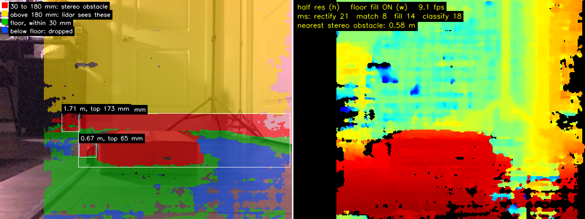

# Test Logs & Build Journal

## Purpose
This file serves as an index of all Project #2 session logs. Each session has its own
dedicated file in this folder with full details. Project #1's sessions, 000 to 017, are in
the [WaveShare-Jetson-ROS2-Rover](https://github.com/ArshamFN/WaveShare-Jetson-ROS2-Rover/blob/main/docs/testing/0000-test-logs.md)
repository.

---

## Session Index

| Session | Date | Title | Status |
|---------|------|-------|--------|
| 001 | 2026-11-05 | Mounting and Calibrating the Stereo Camera, and Finding the Floor | ✅ Complete |

---

## Session 001 — 2026-11-05: Mounting and Calibrating the Stereo Camera, and Finding the Floor
**Goal:** Mount the stereo camera on the rover, calibrate it, check its distances against a
tape measure, and find out how well it sees the floor and the low obstacles the lidar
misses.

**Summary:** I designed a new case that holds the lidar and the stereo camera, with the
lens 23 mm below the lidar's scan plane. The first calibration failed because a hand-held
board moves between the two cameras' unsynchronised exposures. The second passed every
quality check and still read 4.8% short against a tape measure; synthetic tests traced it
to the focal length, which near face-on poses barely constrain, and to a corner search
window wider than the far squares. The third calibration, with every pose tilted 30 to
50°, reads within 1.8% from 0.5 to 2 m, with a 60.18 mm baseline against 60 mm measured.
The floor was the hardest thing to see: pre-shifting the right image by the floor's
expected disparity doubled the correct floor readings. Fitting the floor in every frame
was unstable, so I measured it once with a checkerboard on a box top: 156 mm, about 1.1°
up. A standalone viewer then sorted the scene by height and found an 87 mm box and a tape
measure below the lidar plane at 9 fps on the Jetson. It also merged the box with a door
2.2 m behind it, which showed that obstacles belong on a floor grid, as a Nav2 costmap
builds them, not grouped in the image.

**→ [Full session log](2026-11-05-session-001-Mounting-and-Calibrating-the-Stereo-Camera-and-Finding-the-Floor.md)**

---
