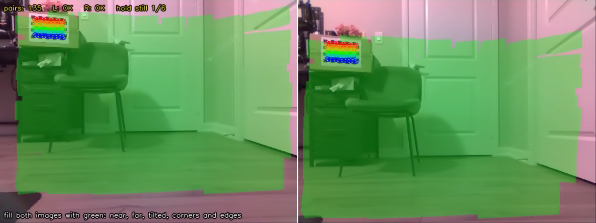
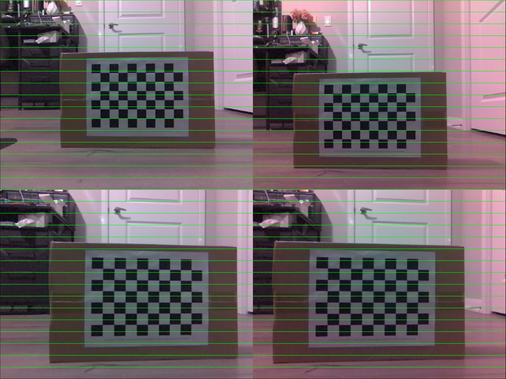
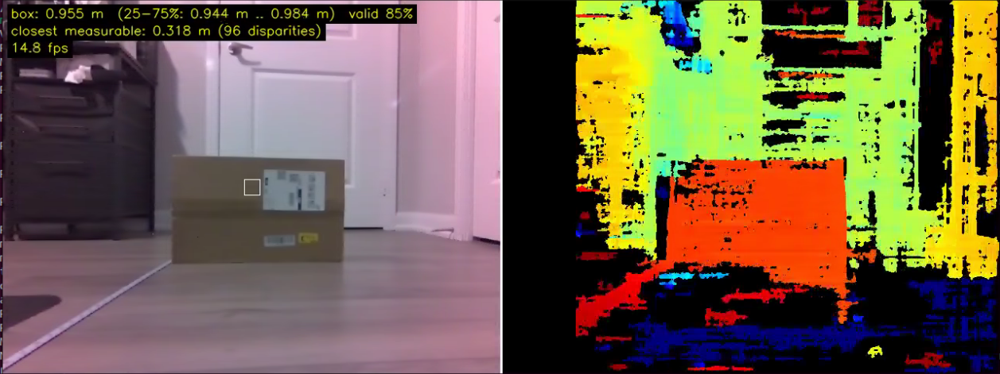
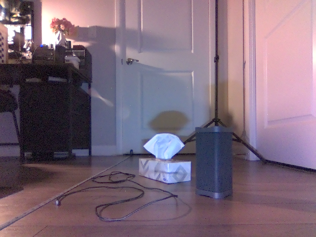
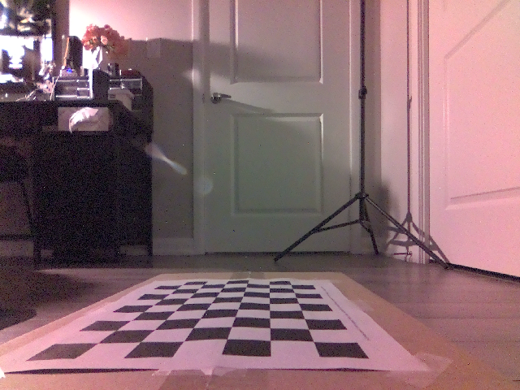
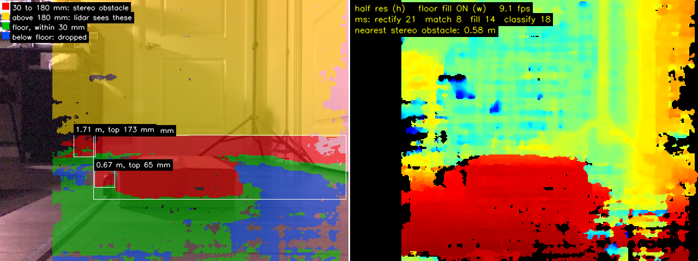
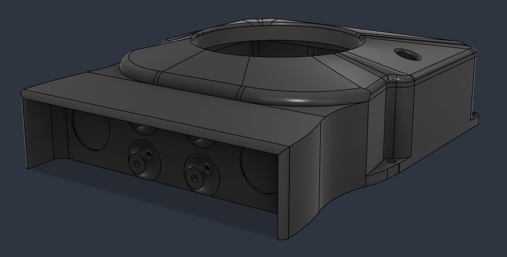
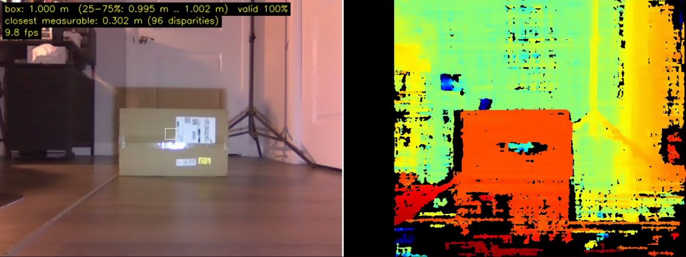

# Session 001 — 2026-11-05: Mounting and Calibrating the Stereo Camera, and Finding the Floor

**Date:** 2026-11-05  
**Status:** ✅ Complete

---

## Goal

Get trustworthy depth out of the stereo camera on the rover: mount it, calibrate it,
check its distances against a tape measure, and find out how well it sees the floor and
the low obstacles the lidar misses.

---

## Context

Project #1 ended with a rover that maps the house on its own after one press of EXPLORE.
Its lidar scans a single plane 180 mm above the floor, so anything lower, like a shoe or
the edge of a rug, is invisible to it. Project #2 adds a stereo camera to see below that
plane.

The finish line I set for Project #2: one press of EXPLORE, and the rover maps the house,
avoids a shoe below the lidar plane, crosses the rug without getting stuck, stops for a
person in its path, and saves a colored 3D layer on top of the lidar map. Stereo depth
feeds obstacle avoidance and that 3D layer; it is not used for localization. People are
detected, not recognized.

The camera is a Waveshare IMX219-83: two 8 MP IMX219 sensors 60 mm apart, 2.6 mm lenses,
and an ICM20948 IMU on the same board. I had tested it on October 5 and 6, while Project
#1 was still running but outside it. Both sensors streamed at about 29.5 fps for 12
minutes with no read failures, their focus matched, and there were no sensor faults. The
test also showed that the right image sits about 50 px lower than the left. The offset
was uniform across the frame and did not move when I pressed the lenses or flexed the
board, and a rigid offset like that is exactly what calibration removes. I wrote the
capture and calibration scripts then and checked them on synthetic image pairs, but
never ran them on the real camera.

The session ran from 2026-11-05 to 2026-11-07.

---

## Discovery 1 — Turning the Module Upright Swapped Left and Right

In October the module sat upside down, so I rotated both images 180° and sensor 1 was
the left camera. In the new case it is upright: no rotation, sensor 0 on the left and
sensor 1 on the right.

I confirmed the assignment from a frame pair instead of reasoning it out. Near features
sat 45 to 52 px further right in the left image, the positive disparity a correct
left/right assignment gives, and the right image was still about 50 px lower, the same
as in October. Both sensors ran at 29.3 to 29.4 fps with no read failures.

---

## Discovery 2 — A Hand-Held Board Moves Between the Two Exposures

The first calibration used 32 pairs of the checkerboard held in my hands. Its stereo
reprojection error was 0.77 px, and after rectification the rows lined up to 0.98 px on
average, with 5% of the corners more than 2.8 px off, against my target of under
0.5 px on average.

Checking each pair on its own showed why. 21 of the 32 pairs were off by a nearly uniform
amount, up to 3.6 px, in a direction that changed from pair to pair. The two sensors are
not synchronised: each runs on its own clock, so a left and right frame can be up to
33 ms apart, and a board in my hands moves in that time. The few pairs I had taken with
the board resting on a box were fine.

From then on the board never touched my hands while a pair was taken.

*Hands-off capture for the second calibration: the board rests on furniture, never in my
hands, and green marks where boards have already covered each image. This run saved 135
pairs.*

---

## Discovery 3 — A Calibration That Passed Every Check Read 4.8% Short

The second calibration used 79 hands-off pairs and passed every quality check I had set:
0.41 px stereo error and rows aligned to 0.38 px. Its rectification check looked right
too:

*Top: the raw pair, with the right image about 50 px lower. Bottom: the same pair
rectified, with each feature on the same green row in both images.*

Then I checked it against a tape measure, with a plain cardboard box straight ahead of the
camera:

| Tape | Stereo reading | Error |
|---|---|---|
| 0.5 m | 0.481 m | -3.8% |
| 1.0 m | 0.955 m | -4.5% |
| 1.5 m | 1.402 m | -6.5% |
| 2.0 m | 1.918 m | -4.1% |

*The second calibration, with the box at 1.0 m on the tape: it reads 0.955 m.*

Every distance read about 4.8% short. A constant percentage points at the scale of the
calibration, the focal length or the baseline, not at the matching. The square size was
not the cause: I had measured the print, 10 squares spanning 249 mm, and used 24.9 mm.
The baseline was off too: 61.53 mm, against the 60 mm I measured between the lens centres
with calipers.

To separate the two, I measured the distance to the checkerboard a second way, from its
known size in one image. That distance read short as well, within 0.7% of the stereo
reading, which pointed at the focal length, the one number both measurements depend on.

---

## Discovery 4 — The Quality Checks Could Not See the Focal Length

I reproduced the problem on synthetic boards rendered with a known camera and found two
causes.

The calibration had dropped 37 pairs as outliers, almost all of them 1.5 to 1.6 m away.
At that distance a square is about 6.6 px wide, and the corner refinement searched an
11 px window, wider than a square, so each corner was pulled toward its neighbours. On
synthetic boards at that distance the corners came out 2.78 px off; with a window
smaller than half a square, 0.41 px.

The bigger cause was the poses. With the board held nearly face-on to the camera (tilts up
to 8°), the synthetic calibration put the focal length at 443.7 ± 20.4 px against a true
434 px, and still graded GOOD on both reprojection error and row alignment. With every
pose tilted 30 to 50°, it found 435.2 ± 1.2 px. A face-on board barely pins down the
focal length, and the error figures I was grading on cannot show that. The focal
length's own uncertainty can.

I changed the calibration script to size the refinement window to the squares and to
print the focal length with its uncertainty, and took the third calibration with every
pose tilted 30 to 50°.

---

## Discovery 5 — The Floor Was the Hardest Thing to See

Once calibrated, depth covered 76 to 84% of the walls, the door and the boxes,
but only 42 to 47% of the bottom third of the image, which is mostly floor. Much of the
floor that did get a reading read 3.5 m or more, where it was 0.3 to 0.6 m away. That is
the part of the image that matters most here, because the obstacles the lidar misses
stand on that floor.

To compare matcher settings on identical data, I saved one scene (a tissue box, a grey
fabric bin and a thin cable on the wood floor) and ran OpenCV's semi-global block
matcher (SGBM) on it offline, on an x86 machine. Only the time ratios between settings
carry over to the Jetson. I scored the open floor against the true floor plane: correct
means within 30 mm of it, below means more than 30 mm under it.

*The saved test scene, from the left camera.*

| Setting | Time | Open floor correct | Below the floor | No reading |
|---|---|---|---|---|
| 3-direction SGBM, 5 px blocks (my viewer's default) | 1.0x | 26% | 7% | 66% |
| 5-direction SGBM, 5 px blocks | 2.5x | 26% | 10% | 64% |
| 8-direction SGBM, 5 px blocks | 5.0x | 21% | 7% | 71% |
| 3-direction, 7 px blocks | 1.0x | 28% | 10% | 62% |
| 3-direction, 9 px blocks | 1.0x | 30% | 13% | 57% |
| 3-direction, 5 px blocks, looser filters | 1.0x | 32% | 21% | 48% |
| 3-direction, 7 px blocks, right image pre-shifted by the floor's disparity | 1.1x | 53% | 11% | 36% |
| 7 px blocks, plain and pre-shifted passes merged | 2.1x | 54% | 17% | 28% |

More matching effort did not help. What helped was the pre-shift. The likely reason is
the viewing angle: the camera sits only 156 mm above the floor and looks almost along it,
so the floor's disparity changes from row to row, and a matching block several rows tall
straddles different depths. Shifting the right image by the disparity the floor should
have at each row takes that change out, and the correct floor doubled from 26% to 53%.
On its own the shift slants vertical surfaces and lost 22% of the bin's pixels; merged
with the plain pass, the bin was whole again.

Two other effects showed up. The floor is glossy: under the bin, it reflected the bin and
read the bin's depth, which puts those points below the floor plane, where they can be
thrown away. And floor readings thin out toward the bottom of the image: 79% of the
pixels in rows 330 to 344 had a disparity, and 2% in the bottom 15 rows.

---

## Discovery 6 — A Flat Cable Is Part of the Floor

I sorted everything the camera sees by height above the floor: more than 30 mm below it
is dropped (mostly reflections), within 30 mm is floor, 30 to 180 mm is an obstacle only
the camera can see, and anything taller the lidar sees as well. On the same scene, the
tissue box's top read 177 mm and the bin's 183 mm, and only 0.1 to 0.2% of the open floor
came out as a false obstacle with any of the settings.

The thin cable read 0 to 1 mm above the floor. No height threshold can separate a cable
lying flat from the floor it lies on, and the rover drives over cables like that without
trouble, so I took them off the finish line. Thick cords and power strips, 3 cm and up,
still fall in the obstacle band.

---

## Discovery 7 — Fitting the Floor in Every Frame Was Unstable

The height bands need to know where the floor is. Fitting a plane to the floor points in
each frame gave a camera height anywhere from 119 to 153 mm and a tilt of 1.5 to 6°,
depending on the fit settings. The visible floor is a narrow strip about 0.35 to 0.7 m
ahead, and over a strip that short, a little more tilt and a little less height fit
equally well. The error matters: 1° of tilt moves the floor 17 mm at 1 m and 35 mm at
2 m, so with a 30 mm floor band the floor itself would start reading as an obstacle past
about 1.7 m.

The camera does not move on the rover, so I measured the floor once instead. The height
from the floor to the centre of the left lens is 156 mm by tape. For the tilt, I glued
the checkerboard to the top of a box 87 mm tall, long side pointing forward, and solved
the camera's pose from the board's corners.

No detector found the board at first: seen at that grazing angle, the far squares are
only about 3.5 px tall. Stretching the image 3x vertically before detection found it in
all four images, and the corners were refined in the stretched image.

*The checkerboard on the box top, 87 mm above the floor, as the left camera sees it.*

I took two captures, turning the box 180° in place between them, and solved each from
both cameras. The left and right cameras agreed within 0.1°, but the two captures
differed by about 0.65°: the box top itself is off level by about 0.3°, and turning it
around cancels that in the average. The result is a pitch of -0.97° and a roll of -0.70°
in the rectified camera frame, the frame the depth comes out in. In the raw camera frame
that is about 1.1° of pitch, pointing up, and 0.14° of roll.

The pose solution put the camera 150.4 to 151.9 mm above the floor, 5 mm under the tape.
Checked against the stereo floor, the tape height fit better: with 156 mm the floor stayed
within 3.5 mm of the plane from 0.35 to 1.5 m, and with 151 mm it was up to 7.6 mm off.
I kept the measured tilt with the taped height and saved it as the floor plane, stored
in the raw camera frame, so a recalibration does not invalidate it; only a new mount
does.

The camera's own IMU agreed on the roll (0.18°) but not on the pitch (0.02°), about 1°
apart. I have not found out why.

---

## Discovery 8 — Grouping Obstacles in the Image Merged a Box With the Door Behind It

I put the floor plane and the height bands into a live viewer on the Jetson that boxes
each obstacle with its distance and height. At 640 x 480 it ran at 4.5 to 4.8 fps in
25 W mode. At half resolution, 320 x 240, it ran at 9.1 to 9.5 fps: matching got about
5.5x faster, and rectifying the full-size colour images became the slowest stage.

The test scene was a closed box 87 mm tall about 0.55 m ahead, with a tape measure lying
beside it. The box's own points put its top at 91 mm at half resolution and 90 mm at full
resolution, and the tape measure showed up as its own obstacle, 63 to 65 mm tall at
0.67 m. Both were real obstacles, found and measured.

The viewer's boxes were wrong, though. It merged the box with the bottom of the white
door 2.2 m behind it into one obstacle 463 px wide. The door has no
texture to match, so its depth smeared forward to 1.6 to 2.0 m, close enough to the box
in the image that they touched. Cutting obstacles apart wherever neighbouring depths
jumped by more than 8% did not separate them, because somewhere along the box's far edge
the steps stayed small, and it cost 11 ms per frame.

*The viewer at half resolution, 9.1 fps. Left: red is 30 to 180 mm above the floor, yellow
is taller, green is floor and blue is below the floor. The box and the door behind it
share one large obstacle box, and the tape measure beside the box is its own obstacle,
65 mm tall at 0.67 m. Right: depth.*

On a top-down grid of the floor, the box and the door are 1.3 m apart. That grid is what
a Nav2 costmap builds from a point cloud anyway, so grouping obstacles in the image is the
wrong place to do it.

---

## Solution / What Was Done

### The mount

I designed a new case in Fusion that holds both the RPLidar C1 and the stereo camera: a
case body, a cap and a separate camera cover. The camera sits level, with its lens centre
23 mm below the lidar's scan plane and its lens front 70 mm ahead of the lidar's spin
axis. Before printing, I held the camera in place and checked the view: the rover's own
body does not appear in the frame, and the first visible floor is about 20 cm ahead of
the robot.

*The final case in Fusion. The RPLidar C1 sits in the round opening on top, and the
stereo camera mounts in the open front, just below the lidar.*

### The camera IMU

The IMU's two data lines go to the Jetson's header (SDA on pin 3, SCL on pin 5, I2C bus
7); it is powered through the camera ribbons. It answers at address 0x68 with the right
identity, and so does its magnetometer. At rest it reads 1.006 g with gyro offsets under
1.1 °/s, +Y points up, and the mount reads level to 0.02° in pitch and 0.18° in roll. The
magnetometer reads about 63 µT at rest and 70 to 80 µT when tilted, so it is distorted
locally and no use for heading without its own calibration.

### The calibration

The final calibration used 37 pairs, the board resting still for every pair and tilted 30
to 50° in every pose, 24.9 mm squares, and the updated script. Using fewer, better pairs
also saved time: the 79-pair calibration had taken about 50 minutes on the Jetson, and
the 37-pair one took a few minutes.

### The floor plane and the viewer

The floor plane (156 mm, pitch -0.97°, roll -0.70°) is saved in its own file next to the
calibration. The viewer runs at half resolution by default, sorts every point into the
height bands from Discovery 6, and boxes obstacles from 30 to 180 mm tall within 2.5 m.

---

## Result

The camera is mounted, calibrated and measuring distance correctly to 2 m.

| Calibration | Result |
|---|---|
| Pairs used | 37 |
| Stereo reprojection error | 0.47 px |
| Row alignment after rectification | 0.34 px mean, 95% of corners within 1.00 px |
| Baseline | 60.18 mm (calipers: 60 mm) |
| Focal length | 423.9 ± 2.0 px |
| Field of view after rectification | 67.2° x 53.0° |

The calibration also settled October's vertical offset. The two cameras' optical centres
differ by 53.6 px vertically while the cameras are rotated only 0.23° in pitch relative
to each other: one lens sits off-centre over its sensor, and the sensors are not tilted.

The same tape test as Discovery 3, with the final calibration:

| Tape | Stereo reading | Error |
|---|---|---|
| 0.5 m | 0.509 m | +9 mm (+1.8%) |
| 1.0 m | 1.000 m | 0 mm |
| 1.5 m | 1.511 m | +11 mm (+0.7%) |
| 2.0 m | 2.016 m | +16 mm (+0.8%) |

There is no scale error left within what this test can measure. The few millimetres
of positive offset are consistent with the camera's optical centre sitting a little
behind the lens front, where I measured from. I have not tested beyond 2 m.

*The final calibration, with the box at 1.0 m on the tape: it reads 1.000 m.*

- **Floor plane:** measured once; the floor reads flat within 3.5 mm from 0.35 to 1.5 m.
- **Obstacles below the lidar:** an 87 mm box at 0.55 m read 90 to 91 mm tall, and a tape
  measure beside it was found as its own 63 to 65 mm obstacle, at 9 fps on the Jetson.
- **Floor coverage:** pre-shifting by the floor's disparity doubles the correct floor
  readings in the scene I tested, from 26% to 53%.

---

## Lessons Learned

**A passing grade is not a measurement.** The second calibration passed every check I had
written and was still 4.8% short. Only the tape measure showed it. The focal length's
uncertainty is a check the error figures cannot replace, so the script now prints it.

**Two unsynchronised cameras need a still target.** Up to 33 ms between the left and right
frames is enough for a hand-held board to ruin a pair without either image looking wrong.

**Measure a fixed quantity once instead of estimating it every frame.** The floor does not
move relative to the camera. One careful measurement beat any per-frame fit.

**Light the scene well.** Good lighting is one of the biggest factors in how well stereo
depth works. The matcher can only find texture both cameras can see, and in dim light the
sensors raise their gain and lengthen their exposure, so noise and motion blur wash out
exactly the fine detail it needs.

**Group obstacles where distance is real.** In the image, a box and a door 1.3 m behind it
can touch. On the floor grid they cannot.

---

## Next Session Goal

Turn the camera into a ROS 2 node: a C++ driver that publishes both images with their
calibration, the stock `stereo_image_proc` pipeline for disparity and a point cloud, and
the camera's measured pose in the URDF. Done when the point cloud lines up with the
lidar scan in RViz.
