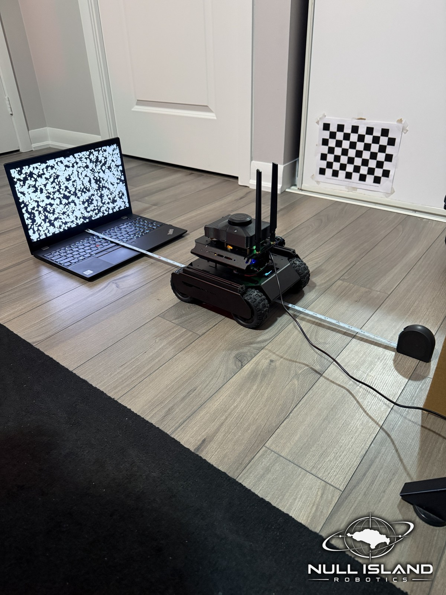

# Session 002 — 2026-11-10: The Stereo Camera Node, and Lining It Up With the Lidar

**Date:** 2026-11-10  
**Status:** ✅ Complete

---

## Goal

Turn the calibrated camera into a ROS 2 node: a C++ driver that publishes both images
with their calibration, the stock `stereo_image_proc` pipeline for disparity and a point
cloud, and the camera's pose in the URDF. Done when the point cloud lines up with the
lidar.

---

## Context

Session 001 ended with a calibrated camera that measures distance to within 1.8% out to 2
m, a floor plane measured once (156 mm, about 1.1° up), and a standalone viewer that
finds obstacles below the lidar plane. None of it was in ROS 2 yet, and the URDF did not
know where the camera was.

Before the camera can feed a Nav2 costmap, its points have to land where the lidar's do.
Position and the floor's tilt were already measured. The one number missing was the
camera's yaw: which way it points on the rover.

The session ran from 2026-11-10 to 2026-11-23.

---

## Discovery 1 — Four Ways to Measure One Angle Gave Answers 3.5° Apart

Session 001's floor measurement gives the camera's height, pitch and roll, but a flat
floor looks the same whichever way the camera is turned, so it says nothing about yaw.

I taped the checkerboard to a closet door at lens height, squared the rover to the door
by measuring both front corners to the wall, centred it on the board, and took a stereo
pair 690 mm away. Four ways of reading the camera's yaw from that one placement:

| Method | Yaw | What it depends on |
|---|---|---|
| Board pose from the left camera alone | 3.4° right | The lens model; a small board seen nearly face-on barely constrains yaw |
| Board pose from the right camera alone | 2.2° right | The same; the two cameras disagree by 1.2° |
| Stereo depth across the board | 0.1° left | The two cameras' focal lengths matching to better than 0.5% |
| Where the board's centre lands | 2.2° right | The rover being exactly centred, and the lens exactly 30 mm off the centreline |

Each method was precise: the corners came out at 0.2 px, and repeating the solution with
noise added moved the answers by a few tenths of a degree at most. But each rested on a
different assumption, and every assumption was worth 1 to 3°.

I tried once more with two distances, because a yaw shows up as a sideways drift that
grows with distance while an offset does not. With a tape measure on the floor as a
guide, I took a pair at 0.5 m, slid the rover straight back and took another at 1.0 m.
Both cameras agreed on 0.73° right. Then two lines fixed in the room, the tape and the
bottom of the door, showed that the rover had turned about 1.5° while it slid, which is
worth several degrees of yaw at that distance.

Every hand estimate landed between 0 and 3.4° right. I stopped building rigs, put 1.5°
right in the URDF as a marked placeholder, and planned to settle it against the lidar
once the camera published a point cloud.

---

## Discovery 2 — The Jetson Has Two OpenCVs

The driver was going to use OpenCV. Checking what was installed showed two versions:
NVIDIA's OpenCV 4.8, which a C++ build finds first, and Ubuntu's 4.5.4, which ROS 2's
`cv_bridge` and `stereo_image_proc` are built against and which Session 001's Python
scripts use. A driver built against 4.8 and loaded next to `stereo_image_proc` would have
put both versions into one process.

So the driver uses no OpenCV at all. It copies each frame from GStreamer straight into
the ROS image message, converting the colour format in the same copy, and reads the
calibration file with yaml-cpp. That also lets it run in the same process as the
`stereo_image_proc` nodes.

---

## Discovery 3 — The Timestamps Are Arrival Times, and the Cameras Are About 11 ms Apart

Both cameras run in one GStreamer pipeline, so they share one clock and start together.
Each frame is stamped with the time its buffer carries, converted to ROS time. Measured
over three 15-second runs, a frame reached the driver 3.4 to 4.6 ms (median) after its
stamp: the stamp is taken when the camera stack hands the buffer out, after exposure,
readout and processing, not when the image was captured. Standing still that does not
matter. Turning, it does: at 1 rad/s, every 10 ms of stamp error turns the point cloud by
0.57° on the map.

The two sensors are not synchronised. The nearest right frame to each left frame was
11.6, 10.8 and 11.0 ms away in the three runs, with the sign changing from run to run. A
random start would put that gap anywhere from 0 to 16.7 ms; three runs at about 11 ms, a
third of the 33 ms frame time, suggest it comes from how the two sensors are started. At
1 rad/s an 11 ms gap is about 5 px of false disparity. At 2 m the true disparity is 14.5
px, so while turning that fast a point at 2 m could read anywhere from 1.5 to 3.2 m.
Standing still, as for every test in this session, it has no effect.

---

## Discovery 4 — My First Measurements Counted What a Lossy Subscriber Receives

My first rate measurements put the point cloud at 2 to 12 Hz, depending on the settings.
They were wrong. The measuring script subscribed with best-effort delivery, and large
messages are split into many network fragments: a best-effort subscriber drops the whole
message if any fragment is lost. On my test machine, a reliable subscriber received the
cloud at 21 to 30 Hz while a best-effort subscriber in the same process received 1.2 to
4.4 Hz.

After that, every measurement subscribed both ways. Both numbers matter: Nav2's obstacle
layer subscribes to point clouds best-effort, so the best-effort rate is what the costmap
will get. The cloud it gets will have to be small.

---

## Discovery 5 — One Thread Was Doing All the Work

`stereo_image_proc`'s launch file puts all its nodes, eight here (colour conversion and
rectification for each camera, disparity, point cloud), into a single-threaded container.
With the rest of the rover idle, the container's busiest thread sat at 93 to 96% while
the Jetson as a whole was at about 72%. One thread was the limit.

I wrote my own launch file that lists the nodes itself and puts them in a container with
a thread pool. It also passes a longer pairing queue (15 frames, about 0.5 s), skips the
colour conversion when colour is not needed, and packs the cloud without padding or
colour: 12 bytes per point instead of 32. With the rover idle, in 25 W mode:

| Container | Images | Cloud, reliable / best-effort | Delay from the frame's stamp (median) |
|---|---|---|---|
| Single thread | grey (mono8) | 21.5 / 11.2 Hz | 261 ms |
| Thread pool | colour (bgr8) | 24.6 / 14.8 Hz | 110 ms |
| Thread pool | grey (mono8) | 26.6 / 17.2 Hz | 88 ms |

Grey images help because the matcher only uses brightness anyway, and they cut the
driver's CPU by about a third.

---

## Discovery 6 — With the Rover's Stack Running, Fewer Frames Gave More Depth

The real test is with BRINGUP and NAV2 running. In 25 W mode the stack on its own used
79% of the six cores: the Foxglove bridge for the pendant 0.8 core, the lidar odometry
0.6, SLAM 0.4, and each of Nav2's servers about 0.2 while idle. About 0.8 core of that
was the remote desktop and my own tools, which are not there when the rover runs on its
own.

With the pipeline added, the Jetson ran at 87 to 95%. At 30 frames per second the cameras
could not keep up, and half or more of the frames the driver and the rectification
handled were never matched. Halving the frame rate gave the matcher those cycles:

| Power mode, camera rate | Cameras delivered | Cloud, reliable / best-effort | Delay (median) | Valid points |
|---|---|---|---|---|
| 25 W, 30 fps | 22.8 / 24.6 fps | 11.1 / 7.3 Hz | 323 ms | 13.9% |
| 25 W, 15 fps | 14.8 / 15.0 fps | 14.0 / 9.8 Hz | 296 ms | 21.3% |
| MAXN SUPER, 30 fps | 26.4 / 25.4 fps | 15.0 / 10.9 Hz | 256 ms | 13.2% |
| MAXN SUPER, 15 fps | 15.0 / 15.0 fps | 14.4 / 10.4 Hz | 142 ms | 20.5% |

All with grey images, a 128 px disparity range and the thread pool. The valid share also
rose at 15 fps in both modes, probably because the longer frame time allows a longer
exposure in evening indoor light; I have not verified that, and a longer exposure means
more motion blur while driving.

I set the pipeline to 15 fps and the Jetson to MAXN SUPER. That meets the target I set
for this session, a cloud at 10 Hz or more while bringup and Nav2 run, even for a
best-effort subscriber. In MAXN SUPER the Jetson module drew 7.1 W with bringup alone
(Nav2 off) and 9.8 W with the pipeline added.

The Foxglove bridge was the biggest single process at 0.8 to 0.9 core, although it only
forwards light topics to the pendant: the map, the transforms, the pendant's states and
the scan visualisation, nothing from the camera.

---

## Discovery 7 — A Wall Cannot Tell a Turned Camera From a Miscalibrated One

With the camera's frames in the URDF, I compared the point cloud with the lidar on a flat
surface: the cloud's points within 2 cm of the lidar's height and the lidar's own points,
both on the rover's frame, each fitted with a line. The angle between the two lines
should be the camera's yaw error.

On a door 2.06 m away the stereo line came out 1.8 cm closer than the lidar's and turned
3.5°. That pointed 2° left, against every hand estimate pointing right. It also cannot be
told apart from a calibration error: a focal-length mismatch between the cameras of 0.18%
(under 1 px, well inside Session 001's uncertainty) tilts a flat surface by the same 3.5°
at that distance. The difference is how they change with distance: a yaw is the same
angle at every distance, a calibration error grows with it.

The door was also a poor target: plain in the middle, so the stereo had points only near
its edges. For the next try I printed a random pattern of black blobs on four letter
pages and taped them to a wall at lidar height. The checkerboard would have been worse:
simulating the pipeline's matcher on a 24.9 mm checkerboard gave 1 to 15% valid points,
and half or more of those were wrong, because repeating squares match in many places. The
random pattern gave 99 to 100% valid points with no wrong matches.

At three distances from that wall:

| Lidar distance | Stereo minus lidar | Angle between the lines |
|---|---|---|
| 0.60 m | -0.8 cm | -6.4° |
| 1.06 m | -1.2 cm | -4.3° |
| 2.02 m | -2.6 cm | -8.0° |

Neither explanation fit: the angle neither stayed constant nor grew steadily. The
differences along the wall were not straight lines either, so part of the error bends the
surface rather than turning it, and the angle depends on which part of the wall each
sensor saw. Distance was good throughout: the stereo read about 1% short of the lidar.

---

## Discovery 8 — A Target With Ends Separates the Two

A flat wall only gives an angle. A flat target of known width gives a position too: where
its two ends are. The direction from the camera to each end depends only on which pixel
column the end falls in, not on the stereo depth, so calibration errors in depth do not
move it.

I put my laptop on the floor 0.5 m in front of the rover, lid upright, showing the random
pattern full screen. The screen is 36.5 cm wide. A script finds it in the lidar scan and
in the point cloud, reports where each sensor puts it, and works out the camera's yaw two
ways: from the position of the screen's ends and centre as seen from the camera, and from
the angle of the screen's surface.

*The laptop test: the screen 0.5 m in front of the lens, showing the random pattern full
screen.*

| Lens to screen | Camera yaw from position | Surface angle left over after that yaw |
|---|---|---|
| 0.52 m | -0.6° | -2.0° |
| 1.04 m | +0.1° | -3.8° |
| 0.51 m (after setting the yaw) | -0.9° | -2.9° |

The lidar measured the screen's width as 36.4, 35.9 and 36.5 cm. The position method says
the camera points about straight ahead relative to the lidar, within 0.6° in every run.
The surface angle left over roughly doubles when the distance doubles, which is the
signature of the stereo calibration, not of the mount. It also varies by about 1° between
placements at the same distance, so it is not a clean focal-length mismatch.

The calibration error is real but separate from the pose: the stereo reads its right side
slightly too near and its left side too far, about 3.7° of tilt per metre on a flat
target. At 2 m that puts the edges of the view 5 to 10 cm off in depth.

---

## Solution / What Was Done

### The driver

The package `stereo_camera_driver` is C++17, with no rover-specific code, so Project #3
can use it as it is.

- One GStreamer pipeline with a branch for each camera, so both share a clock and start
  together. Each sensor runs at 1640 x 1232 (the mode the calibration was taken in),
  scaled to 640 x 480 on the Jetson's hardware.
- It publishes `/stereo/left/image_raw` and `/stereo/right/image_raw` with their
  `camera_info`, built from the calibration file: millimetres converted to metres, and
  the right camera's projection carrying the 60.18 mm baseline. It refuses to start if
  the file does not match the cameras.
- Parameters for the image format (colour or grey), the frame rate, the sensor mode and a
  test pattern instead of the cameras. The launch file logs the calibration file's
  checksum.
- Every few seconds it logs each camera's frame rate, the delay from stamp to arrival,
  and the gap between the left and right frames.
- Seven unit tests cover reading the calibration file, including a swapped file, a
  missing value and a principal point outside the image.

In its own test on the rover, both cameras ran at 29.6 to 30.0 fps in the sensor mode it
asked for, and every stop was clean.

### The calibration file

The rover's calibration file moved into the repository, under
`robot_description/config/`, and the launch file passes it to the driver. Its checksum
matches the file from Session 001.

### The depth pipeline

`robot_description`'s `stereo.launch.py` starts the driver and the `stereo_image_proc`
nodes from Discovery 5 in one process with a thread pool. Its defaults come from the
measurements: grey images, 15 fps, a packed cloud without colour, a 15-frame pairing
queue. The disparity range stays at the stock 64 px for now, which sees nothing nearer
than 0.45 m; 128 px reaches 0.23 m but loses the leftmost 128 columns of the image, a
fifth of its width, and costs about 2 Hz.

### The camera in the URDF

Four new frames hang off the rover's `base_link`:

| Frame | What it is | From |
|---|---|---|
| `stereo_left_link` | The left camera as it sits on the rover | Position: lens front 70 mm ahead of the lidar's spin axis (optical centre about 67 mm), 30 mm left of the centreline, 156 mm above the floor. Pitch and roll: Session 001's floor plane. Yaw: -0.3°, measured against the lidar (Discovery 8) |
| `stereo_left_raw_optical_frame` | The same camera in image axes (x right, y down, z forward) | Convention |
| `stereo_left_optical_frame` | The rectified left camera: the frame of the images, the disparity and the point cloud | The calibration's rectification, a fixed 1.22° turn |
| `stereo_right_optical_frame` | The rectified right camera | 60.18 mm to the right, the calibrated baseline |

Leaving the rectification out would have shifted every point sideways by 15 mm at 1 m and
30 mm at 2 m. I checked the frames as the rover publishes them: the rectification matches
the calibration, the right camera sits exactly one baseline away, and Session 001's floor
points straight down, each within 0.0000005.

### The yaw check script

`tools/stereo_calib/lidar_camera_yaw.py` is the script from Discovery 8. It runs while
bringup and the depth pipeline are running and the rover stands still, and takes the
target's width as an argument:

1. It takes 20 seconds of lidar scans and point clouds.
2. In the lidar data, it takes the median range of each beam, splits the beams into flat
   pieces wherever the range jumps, fits a line to each piece, and picks the piece whose
   width matches the target's.
3. In the point cloud, it takes the points within 2 cm of the lidar's height, sorts them
   by direction from the camera in quarter-degree steps, and does the same. A plain
   stripe on the target, such as a screen's border, can split it into pieces;
   neighbouring pieces on one line are joined.
4. It reports where each sensor puts the target: distance ahead, offset to the side,
   angle and width.
5. It finds the turn about the camera that best puts the stereo target's ends and centre
   on the lidar's: the yaw from position. It also reports the difference between the two
   surface angles: the yaw from the surface.
6. It recommends the position yaw, says whether the two methods agree within 1°, and says
   how to tell a mounting error from a calibration error by repeating at twice the
   distance.

Before it ran on the rover, I tested it on simulated scenes with a known camera yaw: it
recovered a true -2.7° as -2.6° and a true +3.0° as +2.9°, and with a calibration error
added the position yaw stayed right while the surface yaw was off by 0.9°.

---

## Result

The camera is a ROS 2 node, its point cloud is in the rover's frames, and it lines up
with the lidar.

| | Result |
|---|---|
| Cameras | 15.0 fps each in the pipeline (30 fps available), grey |
| Point cloud with bringup and Nav2 running | 14.4 Hz reliable, 10.4 Hz best-effort, 142 ms median delay (MAXN SUPER) |
| Camera yaw | -0.3° relative to the lidar; every laptop run within 0.6° of it |
| Distance against the lidar | Stereo 0.9 to 2.2% short, 0.5 to 2 m |
| Flat surface | Reads tilted about 3.7° per metre of distance (stereo calibration) |
| Jetson power (module only) | 7.1 W with bringup, 9.8 W with the pipeline, MAXN SUPER |

The pipeline does not stop cleanly yet: on Ctrl+C the container crashes, a known ROS 2
problem, and the driver sometimes takes more than 5 seconds. That has to be fixed before
the pipeline goes into the bringup service. I have not checked depth beyond 2 m, and the
camera's IMU is not in ROS 2 yet.

---

## Lessons Learned

**A precise measurement can still be wrong.** Four readings of one angle each repeated to
a few tenths of a degree and disagreed by 3.5°. Precision says how well a method repeats,
not how well its assumptions hold.

**Measure what the consumer will receive.** On my test machine, a cloud a reliable
subscriber received at 21 to 30 Hz reached a best-effort one at 1 to 4 Hz. The number
that matters is the one at the receiving end, with the settings the receiver uses.

**Fewer frames can mean more depth.** With the Jetson busy, frames the matcher could not
keep up with only took CPU away from it. Halving the camera rate raised the cloud rate
and cut the delay in half.

**A wall gives an angle; a target with ends gives a position.** An angle mixes the
camera's pose with its calibration. Where the ends of a target appear depends only on the
pose.

**A checkerboard is a calibration target, not a stereo target.** Its repeating squares
match in many places. Random texture matches in one.

---

## Next Session Goal

Make a flat surface read flat: find and fix the stereo calibration's tilt, checked with
the laptop test at 0.5 and 1 m, where the surface angle should come out within 1° of the
lidar's. Then the camera's IMU as a ROS 2 node, capture-time stamps from the camera
stack, a clean shutdown of the pipeline, and a small cloud of the obstacle band for Nav2.
